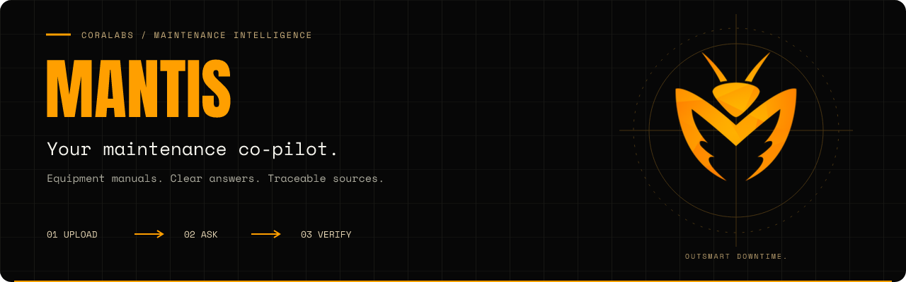
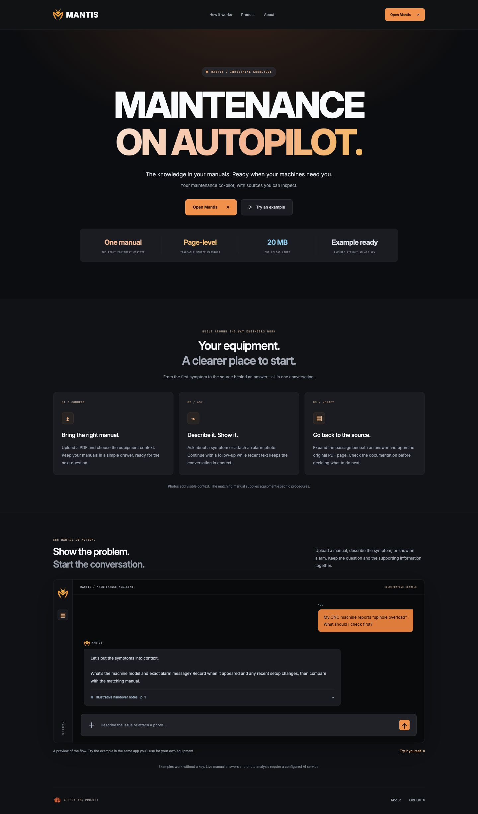
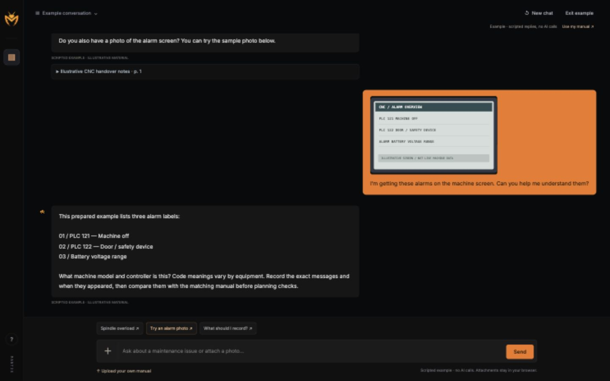

<p align="center">
  
</p>

<p align="center">
  <a href="https://github.com/stefisha/Mantis/actions/workflows/checks.yml"></a>
  
  
  
</p>

<p align="center">
  <a href="#quick-start">Quick start</a> ·
  <a href="docs/about.md">About</a> ·
  <a href="docs/running.md">Run & troubleshoot</a> ·
  <a href="docs/architecture.md">Architecture</a> ·
  <a href="docs/verification.md">Verification</a> ·
  <a href="CONTRIBUTING.md">Contributing</a>
</p>

# Your maintenance knowledge. One question away.

**Mantis helps maintenance engineers find answers in equipment manuals and trace them back to the source.** Upload a PDF, select the right equipment manual, and ask about a symptom, fault code, or maintenance procedure. Inspect the supporting passages and open the original PDF at the cited page.

It began as an exploratory PDF-chat prototype. It now includes a product landing page, a single chat app, a persistent manual library, browser-scoped workspaces, single-pass indexing, validated citation identifiers, and an offline demo. Speech and object-detection notebooks remain research work.

## One conversation for the job

The product page opens with a full-screen gradient hero, followed by a concise “How it works” section and a crisp HTML/CSS preview. Team credits and deeper technical details live in the docs. **Open Mantis** opens the working chat: upload a manual, ask a question, attach a photo, and expand sources beneath the answer. **Try an example** opens that same interface with a sample conversation. Manuals live in a small drawer; there is no separate demo interface or library page.





## What you can do

| Workflow                   | What Mantis provides                                                                           |
| -------------------------- | ---------------------------------------------------------------------------------------------- |
| **Build a manual library** | Upload text-based PDFs, add equipment labels, and keep documents across restarts.              |
| **Ask the right source**   | Scope each question to one selected manual so equipment documentation stays separate.          |
| **Inspect an answer**      | See cited excerpts, page numbers, and the original PDF at the referenced page.                 |
| **Manage your workspace**  | Reuse duplicate files, delete individual manuals, or clear documents and their indexes.        |
| **Try it without a key**   | Try a scripted CNC conversation, a prepared alarm-screen example, and local photo previews with no AI calls. |

The current app is a **local pilot**. It does not operate machines or certify maintenance work. The last four successful text exchanges provide follow-up context. Starting a new chat, changing manuals, or changing between live/example modes clears that context. Check answers against the cited manual and approved site procedures.

## Quick start

Use Python 3.9+ from a source checkout. Local checks have run on Python 3.9; CI runs on Python 3.12. Node 22+ is needed only for frontend development checks.

```sh
git clone https://github.com/stefisha/Mantis.git
cd Mantis
python3 -m venv .venv
source .venv/bin/activate  # Windows PowerShell: .venv\Scripts\Activate.ps1
python -m pip install --upgrade pip
python -m pip install -r requirements.lock
python -m pip install -e . --no-deps
python -c "from pathlib import Path; p=Path('.env'); p.exists() or p.write_bytes(Path('.env.example').read_bytes())"
mantis --reload
```

Open the **[product page](http://127.0.0.1:8000)** or go directly to the **[workspace](http://127.0.0.1:8000/workspace)**. The product page is at `/`; the working assistant is at `/workspace`. FastAPI serves both the UI and API; there is no separate frontend server or build step. The setup command preserves an existing `.env`. See [running and updating](docs/running.md) for alternative entry points, environment/data locations, and troubleshooting.


### 1. Try the same app with an example

Choose **Try an example**, or open [`/workspace#demo`](http://127.0.0.1:8000/workspace#demo). The chat starts with a scripted spindle-overload scenario. Try the illustrative alarm-screen attachment, ask a maintenance handover question, and expand the sample source. No API key or AI calls are involved. Personal photos attached in example mode stay in the browser and are not analyzed.

Choose **Exit example** or upload your own manual to leave example mode. Then attach a photo or ask about the selected manual to use the real backend. Switching modes resets the conversation, so example replies never enter a live request's history.

### 2. Connect your manuals

Set `OPENAI_API_KEY` in the local `.env` file, then restart the server. Upload a text-based PDF, optionally label its equipment model, and select it before asking a question. Defaults allow 20 MB and 300 pages per PDF, with up to 30 manuals per workspace.

Manual text is sent to OpenAI for embeddings; questions, recent text context, photo observations, and retrieved excerpts are sent for answer generation. The original PDF stays in the local database. See [configuration and data flow](docs/configuration.md).

### 3. Show the alarm

In live mode, attach one JPEG, PNG, or WebP photo (up to 8 MB and 20 megapixels) beside the message. Mantis sends it to OpenAI to read visible details and alarm text. With a selected manual, those observations inform retrieval before a source-backed reply is generated. Without a manual, replies are limited to observations and collecting context, with no fabricated manual citations. A photo is not a verified diagnosis.

Live image handling follows the [official OpenAI image-input format](https://developers.openai.com/api/docs/guides/images-vision). The configured chat model must support image input and strict structured outputs. This request path has been tested with a fake provider; live image accuracy and provider compatibility still need validation with a valid key.

Mantis does not persist photos or conversations. The browser sends the last four successful text exchanges as follow-up context; old image bytes are not resent. Reattach a photo when it needs to be examined again. The provider's data-processing policies apply to live requests.

### 4. Verify the source

Select a citation to inspect its passage or open the PDF at the referenced page. A retrieval cutoff can return an insufficient-evidence response. Valid source identifiers do **not** prove that every generated claim is supported; a representative answer-quality evaluation is still needed.

## How it works

**PDF → page-local chunks → embeddings → selected-manual retrieval → structured answer → validated source IDs.**

FastAPI handles requests; SQLite stores manuals, chunks, and embeddings. The frontend is plain HTML/CSS/JavaScript, organized into a compact product page and one working chat. Duplicate detection and quota enforcement are serialized in a write transaction. An ASGI body limiter rejects oversized uploads before multipart/JSON parsing.

Read the [architecture guide](docs/architecture.md) for retrieval behavior, concurrency, isolation, and scale boundaries.

## Quality and current limits

- **34 Python regression tests** cover real PDF extraction with a fake provider, storage isolation, persistence, deletion, concurrency, request limits, and citation handling.
- **12 frontend regressions** cover bounded follow-up context, stale responses and reset cancellation, retry handling, mode/manual resets, current-message-only photos, and key-free examples.
- **CI** runs Python/frontend tests and lint/format checks, JavaScript syntax/format checks, and an independent built-wheel smoke test for pages, assets, and the demo API.
- **Browser checks** cover desktop/mobile layouts, demo citations, keyboard focus, and cancelling/reselecting a file.
- **Still to evaluate:** representative industrial answer quality and live-provider behavior. Software tests are not evidence of troubleshooting accuracy.

Workspaces are remembered by an opaque browser cookie, not an employee account. Clearing cookies loses access to that workspace. Scan-only PDFs require OCR before upload. Team authentication and shared hosting are not included. Read the [verification record](docs/verification.md) and [deployment guidance](docs/deployment.md) before extending the local pilot.

## Project map

```text
app.py                   Compatibility ASGI entry point
mantis/api.py            Application factory and same-origin API
mantis/main.py           Packaged ASGI entry point
mantis/cli.py            Local server command
mantis/web/              Packaged product page, workspace, styles, scripts, and assets
mantis/                  PDF chunking, transactional storage, upload-body middleware
tests/                   Generated-PDF, API, storage, and concurrency regressions
docs/                    About, running, API, architecture, configuration, verification
scripts/                 Frontend syntax and built-wheel smoke checks
Makefile                 install, run, check, and format shortcuts
.github/workflows/       CI checks
requirements.lock        Pinned Python runtime and development dependencies
package-lock.json        Pinned frontend development tools
notebooks/               Historical PDF, speech, and object-detection experiments
```

## Development

```sh
npm ci --ignore-scripts
pytest -q
ruff check app.py mantis tests scripts
ruff format --check app.py mantis tests scripts
npm run check
npm test
npm run format:check
```

With the environment activated, `make install`, `make run`, `make check`, and `make format` provide the corresponding shortcuts. The package build/check commands are documented in [CONTRIBUTING.md](CONTRIBUTING.md#check-the-built-package).

Tests generate their own PDFs and use a fake AI provider; no live key or billable calls are needed. Read [CONTRIBUTING.md](CONTRIBUTING.md) for code, interface, and documentation changes.

## About the project

Mantis is a **CoraLabs** maintenance-assistance project. Its next steps are representative retrieval evaluation, account-owned team workspaces, and a shared-deployment design. Voice transcription and visual part identification remain experiments rather than product promises.

[Meet the project](docs/about.md) · [Configuration](docs/configuration.md) · [Architecture](docs/architecture.md)

## Credits and asset terms

The Mantis and CoraLabs marks come from the original project presentation. Inter, JetBrains Mono, Anton, and Space Mono are bundled under the SIL Open Font License; see [asset provenance and licenses](mantis/web/assets/README.md). Research notebooks use Whisper and Grounding DINO.

No project-wide code license is included yet. Credentials and private manuals belong outside Git; see [credential handling](docs/deployment.md#credentials) for the historical prototype cleanup.
