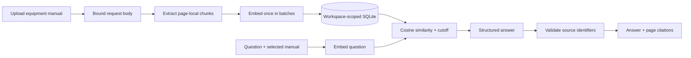

# Architecture

Mantis is a same-origin FastAPI application with a buildless HTML/CSS/JavaScript frontend. The application factory is `mantis/api.py`, with the ASGI instance in `mantis/main.py` and the `mantis` command in `mantis/cli.py`. Root `app.py` preserves the original Uvicorn entry point. The notebooks in `notebooks/` retain historical experiments.

## Indexing and persistence

`mantis/middleware.py` bounds upload bodies before multipart parsing, including chunked requests and misleading Content-Length headers. File-size, page-count, and chunk-count limits also bound accepted input. Scan-only PDFs need OCR before upload.

`mantis/rag.py` extracts overlapping chunks within individual pages, preserving neighboring lines. OpenAI embeds each chunk once, in batches. `mantis/store.py` stores the original PDF, equipment label, chunks, embeddings, and embedding model in SQLite.

A `(workspace, digest)` index supports metadata-only duplicate detection. An immediate write transaction serializes the final duplicate check, document quota check, and insertion. Foreign-key cascading deletes chunks when their document is deleted.

## Retrieval and answers

Each question specifies one manual. Retrieval embeds the question using that manual's stored embedding-model identifier, then calculates cosine similarity against that manual's chunks. A configurable threshold filters weak matches before generation.

The model returns a structured answer and source identifiers. The API checks that identifiers refer to retrieved passages and that a substantive answer has sources. These checks establish source identity; they do not prove that every answer claim is supported. The threshold and answer behavior need evaluation against representative manuals and questions.

Each question is independent. The visible chat is a session transcript, not model conversation memory.

## Workspace boundary

An opaque HttpOnly, SameSite=Lax cookie identifies the browser workspace. SQLite persists its manuals across restarts. Clearing the cookie loses access to that workspace. Cookies isolate browser workspaces but are not employee authentication or account-based ownership.

The API blocks unsafe requests from other origins, validates Host headers, renders document content as text, and uses a local request limiter. Provider failures return a generic error; document text, questions, and generated answers are not logged by the application.

## Deployment scale

The current limits are 30 manuals per workspace and 2,000 chunks per manual. Brute-force similarity search and the in-process rate limiter support a small local pilot. Shared hosting requires authentication, shared rate limiting, operational storage policies, and an isolated parser for hostile input. See [deployment guidance](deployment.md).

## Product and frontend layout

`/` serves the product presentation; `/workspace` serves the working assistant. Both pages are packaged under `mantis/web/pages/` and use self-hosted assets. CSS lives in `mantis/web/css/`; JavaScript modules live in `mantis/web/js/`. The product demo and workspace share an API client module. Product navigation uses real section anchors and links into the workspace. Demo mode is activated by `/workspace#demo`.

The landing page follows the owner-supplied design reference while using the original presentation's logos, team portraits, names, and role labels. Mock telemetry, inventory records, invented performance figures, and unsupported certifications from the reference are not product data.

The Python wheel includes HTML, CSS, scripts, fonts, logos, and portraits through setuptools package data. Runtime data and `.env` are resolved from the working directory, so an installed package can run outside the source checkout.
